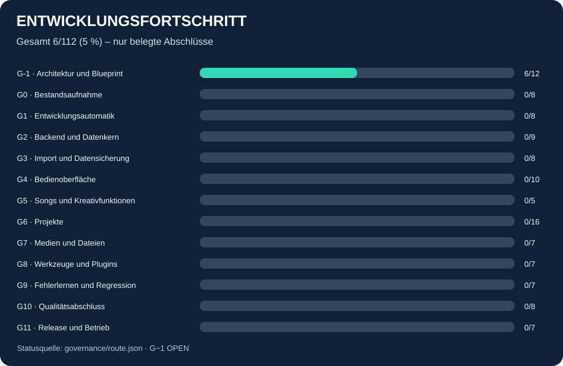

# TOOL_ZENTRALE

**PROVOWARE – geplante modulare HTML-Webanwendung für Kreativarbeit, Projekte und Organisation.**

Status: **Planung V3.2 (Entwurf) / noch keine lauffähige Anwendung** (25.10.2026).
Dieses Repository enthält zunächst ausschließlich freizugebende Architektur-
und Entwicklungsunterlagen. Der existierende Desktopcode aus
[TOOL_2026_Multi](https://github.com/provoware/TOOL_2026_Multi) bleibt unangetastet.

## Entwicklungsstand zum Anklicken und Nachverfolgen

**[Nummerierte TODO mit GitHub-Abhakkästchen öffnen](docs/TODO_V3_2.md)**

Die Anzeige wird aus `governance/route.json` erzeugt. Ein Häkchen zählt erst
nach `VERIFIED` und Prüfnachweis; das bloße Bearbeiten des Markdown-Kästchens
gilt nicht als Abschluss. G−1 und der Plan bleiben noch nicht freigegeben.

**[Kurzstatus und nächste drei Schritte](docs/STATUS_KURZ.md)** ·
[Arbeitsweise und Aktualisierungstrigger](docs/ARBEITSWEISE.md) ·
[Audit und Prüfgrenzen](docs/AUDIT_2026_10_25.md)

## Automatische Entwicklungshilfe

Einmalig: `python3 -m pip install -r requirements-dev.txt`.
`python3 scripts/assist.py` prüft Register, Informationsdateien, Evidenz, Gates und Regressionen.
`python3 scripts/assist.py --refresh` aktualisiert zusätzlich abgeleitete Ansichten.
[Erklärung und Lernregeln](docs/REGRESSION_INFO.md) ·
[Abschluss- und Gatevertrag](docs/ABSCHLUSS_UND_GATES.md) ·
[Früher Laienablauf](docs/FRUEHER_LAIENABLAUF.md) ·
[Geprüfte Grundlagen und offene Punkte](docs/GRUNDLAGE_B001_B003.md) ·
[Schichten, Dateiabgleich und Codelegende](docs/ARCHITEKTUR_B004_B006.md).

## Einstieg für Laien

Die Anwendung wird später lokal im Browser unter Linux/Kubuntu gestartet,
mit verständlicher Führung, vergrößerbarer Oberfläche, Tastaturbedienung,
kontextbezogener Hilfe und sicheren Speicher-/Wiederherstellungswegen.
**Es gibt aktuell noch nichts zu installieren oder auszuführen.**

## Verbindliche Planunterlagen

1. [Masterplan 3.1 – 112 nummerierte Schritte / 13 Gates](docs/MASTERPLAN_V3_1.txt)
   und [verbindlicher V3.2-Ergänzungsentwurf](docs/MASTERPLAN_V3_2_DELTA.txt)
2. [UX und Barrierefreiheit – WCAG 2.2 AA als Ziel](docs/UX_BARRIEREFREIHEIT.md)
3. [Entwicklungs- und Patchstandard](docs/ENTWICKLUNGSSTANDARD.md)
4. [Überarbeiteter Auftrag](docs/PROMPT_OPTIMIERT.txt)
5. [Primärquellen und Projektbelege](docs/QUELLEN.md)
6. [Architektur-Blueprint – virtuelle Dateien, Kurzcodes, Szenarien](blueprint/architecture.yaml)
7. [Maschinenlesbare Entwicklungsroute](governance/route.json)
8. [Arbeitsregeln für Programmierung und Prüfer](AGENTS.md)
9. [Intelligente TODO und Fortschritt](docs/TODO_V3_2.md)

## Fixierte Identität

- Repository: `provoware/TOOL_ZENTRALE`
- Lokaler Projektpfad: `PROVOWARE/TOOL_ZENTRALE/`
- Ein Git-Repository, ein fester Kern, funktionsorientierte Modulbereiche.
- Andere PROVOWARE-Projekte dienen nur als lesbare Referenzen.
- Nutzerdateien, Datenbanken, echte Backups und persönliche Logs gehören
  **nicht** in dieses öffentliche Repository.

## Freigabegrenze

Ein grüner Architekturgraph oder eine vollständige Outline ist kein echter
Funktionstest. Eine spätere Implementierung benötigt eigene Freigabe,
gezielte Tests und dokumentierte Qualitätsgates.

Änderungen an der Planung werden über Pull Requests begutachtet.
